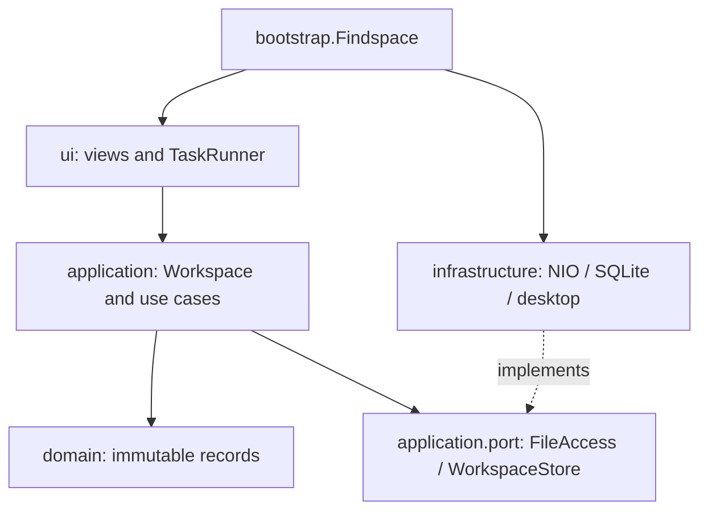

# System design

Findspace is a single-process desktop application. Packages divide responsibilities
without introducing network services or a dependency-injection framework.

ArchitectureTest checks that domain/application do not import Swing, SQL or
infrastructure. Views use desktop integration for reveal/open actions; business
operations go through application workflows.

| Concern | Owner |
| --- | --- |
| Classification | Category |
| Current immutable index and workflow coordination | Workspace |
| Literal search, filter, sorting | SearchService |
| Destinations and expiring previews | OrganizationService |
| Journaled move, undo and recovery protocol | MoveService |
| Size → hash → distinct file identities | DuplicateService |
| Containment, links, fingerprint and filesystem effects | NioFileAccess |
| Volume serial and 128-bit Windows file ID | WindowsFileIdentity |
| Database transactions and migration backup | SqliteWorkspaceStore |
| One background worker and event-thread callbacks | TaskRunner |
| OS file lock and legacy-compatible Windows mutex | InstanceGuard |
| Hover navigation, paging and stale-result rejection | FolderOrb |
| Radial geometry and animation | RadialLayout / OrbCanvas |
| Pins and appearance preferences | SettingsDialog / UserSettings |
| Read-only folder and Windows shortcut discovery | DesktopCatalog |

## Move protocol

1. UI requests a preview; planner generates immutable destinations and retains it by ID.
2. User selects source paths and confirms. Workspace asks the planner to consume the
   preview after checking ownership, age, root and selection.
3. MoveService validates paths, fingerprints and digest.
4. Store persists a pending journal record before filesystem effects.
5. Filesystem creates an exclusive hard link, verifies identity/content, unlinks
   the original and marks the journal moved. Workspace rescans.

Recovery promotes pending to moved only when the source is absent and destination
matches its digest. Undo is symmetric and journals undo_pending. Both paths are
preserved when ambiguous. Accessibility errors are not treated as proof of absence.
Recovery is scoped to the selected folder. Other folders' history stays untouched.

## State and concurrency

The Python moves table is retained. java_files/java_meta own the new Java index;
legacy files/meta remain untouched. SQLite VACUUM INTO creates a consistent backup
before first migration of an existing journal, including committed WAL transactions.

One worker serializes slow operations and returns results to Swing's event thread.
Overlapping jobs and quitting during work are blocked. Workspace methods synchronize
non-UI callers too. Search is debounced and reruns when input changes during work.
Hashing uses a 64 KiB buffer; scans retain metadata in memory. The planner retains
five previews and the table shows up to 5,000 matches. These are explicit limits,
not claims of full-drive scalability. Traversal/hashing check interruption; the UI
does not expose cancellation yet because mutations require durable stop boundaries.

## Decisions and limitations

Swing/FlatLaf offers standard accessible widgets, themes and a direct Java learning
path. SQLite avoids a database service. Windows JNA calls are isolated in adapters.
Hard links intentionally exclude cross-device moves. Fingerprint/hash checks reduce
accidental races but do not provide an adversarial filesystem transaction.
The orb is a floating window, not a Windows shell extension. It uses per-pixel
transparency where supported. Its independent read-only SwingWorker cancels stale
navigation requests; generation checks prevent old results replacing new content.
Hover only lists folders; opening requires a double-click or explicit menu action.
The idle shell is only an A badge. Child geometry is anchored to the hovered folder,
not the launcher center. Pointer exit uses the navigation area rather than the
transparent window rectangle, with a short grace period for traversing gaps.
DesktopCatalog merges personal/public desktop items and pins by normalized path.
It refreshes on expansion without relocating any source files.
Pins store paths, never copies. Software management opens installed shortcuts or
Windows settings rather than relocating application installations.
